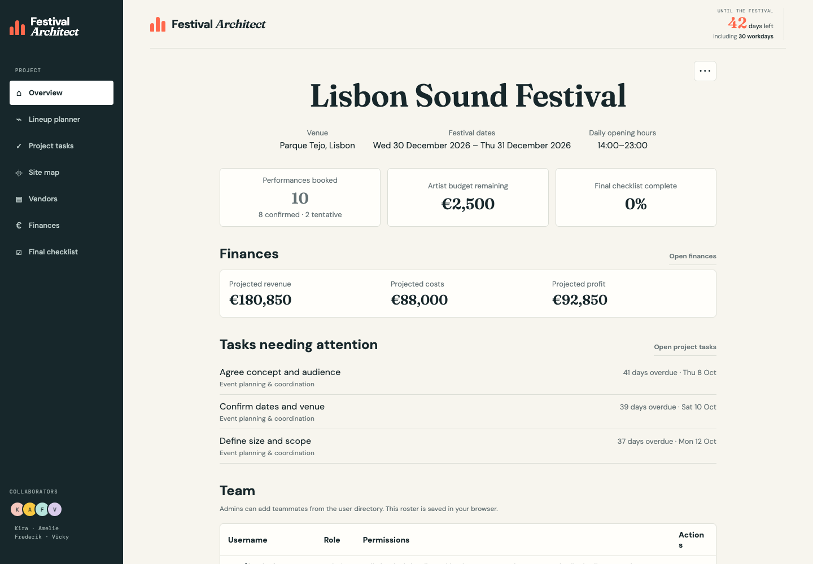
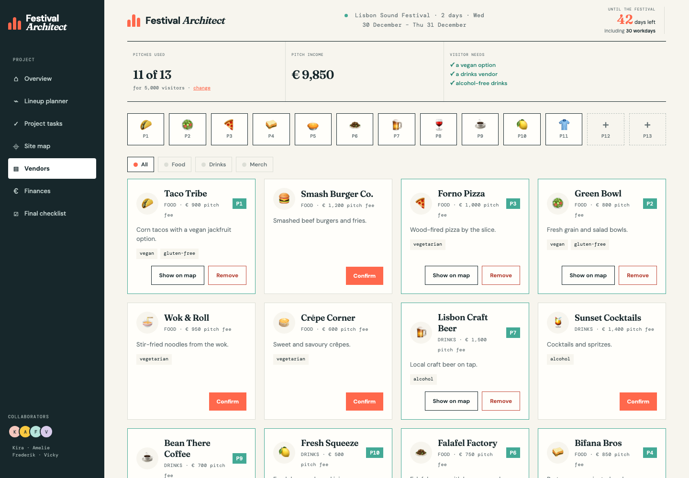
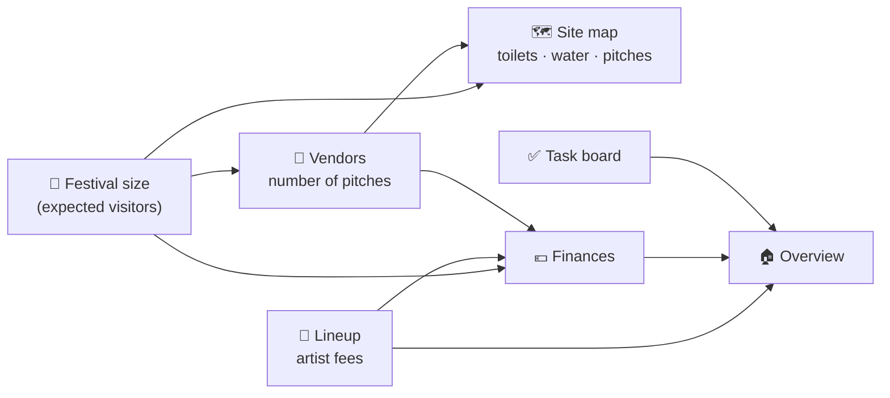

<div align="center">

# 🎪 Festival Architect

**Plan a complete music festival in one place —**
**from the first artist booking to the last check before the gates open.**


Team project · *Introduction to Programming* · **Nova SBE**
Kira · Amelie · Frederik · Vicky

[Quick start](#-quick-start) · [Features](#-features) · [Screenshots](#-screenshots) · [How it fits together](#-how-it-fits-together) · [Tests](#-tests) · [Project structure](#-project-structure) · [Roadmap](feature-plans/roadmap.md)

<br />



</div>

---

## 🚀 Quick start

You only need **Python 3** (already installed on macOS). No packages, no setup.

```bash
python3 server.py
```

Open **<http://127.0.0.1:8000/>** and keep the terminal running while you use the app.
Stop the server with `Ctrl + C`.

> [!TIP]
> On the first visit the Overview asks for the festival name, dates and opening hours —
> after that every section is ready to use.

## ✨ Features

### Plan the programme
- **Overview** — the start page: festival details, projected finances, tasks that need
  attention, milestones and the team roster.
- **Lineup planner** — a multi-day timetable for several stages. Book artists with agreed
  fees and set lengths, mark them tentative or confirmed, add calendar blocks, keep an eye on
  the budget, finalise the plan, print it as a PDF and save or restore a backup.

### Organise the work
- **Task board** — project tasks with deadlines, a "needs attention" list and an editable
  **Gantt chart** of the whole preparation, plus a countdown to the festival.

### Design the ground
- **Site map** — a realistic aerial view with a clickable pin for every facility: stages,
  gate, first aid, toilets, water, food court, emergency exits and more.
  - Upload your **own map** (aerial photo or site plan), draw the fence, set the gate and
    mark no-go areas — water is detected automatically.
  - **Suggest optimal layout** places everything according to **10 layout rules**
    (stage distance, first aid / toilets / water near every stage, exits far apart …),
    with a score. Drag pins to adjust; walkways route around water and forest.
  - **Festival size:** the expected visitors decide how many toilets, water points, food
    pitches, first aiders and security staff are needed.
- **Vendors** — 24 food, drink and merch vendors for the food court pitches, pitch income
  and a check that visitors' needs are covered (vegan option, drinks, alcohol-free).

### Know the numbers
- **Finances** — profit and loss, **break-even** (tickets and price), where the money goes
  and comes from, **profit by ticket price**, **scenarios** (bad weather · plan · sold out)
  and an analysis of the artist spending. Every assumption can be changed.

### Get ready for the day
- **Final checklist** — event-day checks for 12 teams, from security to radios, with a
  progress bar.

## 📸 Screenshots

All screenshots show the example festival *Lisbon Sound Festival* (2 days, 2 stages,
5,000 visitors).

| Lineup planner | Site map |
| --- | --- |
|  |  |
| **Vendors** | **Finances** |
|  |  |

## 🔗 How it fits together

The sections share their data, so a change in one place shows up everywhere it matters.



## 🧪 Tests

All rules and calculations are covered by automatic tests.

```bash
uvx --from nodejs-wheel node --test                     # JavaScript
python3 -m unittest discover -s tests -p 'test_*.py'    # Python
```

`uv` downloads Node by itself — nobody has to install Node.

## 📁 Project structure

```text
index.html                    page structure for all sections
styles.css                    shared look
server.py                     local server + SQLite username lookup
app.js                        lineup planner
overview.js                   overview and team roster
work-board.js · gantt-*.js    task board and Gantt chart
festival-countdown.js         days until the festival
site-map/                     site map and the aerial drawing
vendors/                      vendors
finance/                      financial overview
checkliste-festivalplanung/   final checklist
rules/                        all rules and calculations — no screen code
tests/                        automatic tests (JavaScript and Python)
feature-plans/                one plan per feature, plus the roadmap
product-brief/                the product brief
```

## 🧭 Design principles

- **Rules are separate from screens.** Every rule and calculation lives in `rules/`; the
  screens only show things and pass clicks on. That is why everything can be tested
  without a browser.
- **No dependencies.** Plain HTML, CSS and JavaScript in the browser, the Python standard
  library on the server. Nothing to install, nothing that breaks on update.
- **The brief decides.** [`product-brief/`](product-brief/festival-architect-brief.html)
  wins over anything else.

## 🔒 Data & privacy

Everything stays on your computer. The festival plan is saved in your browser
(localStorage) for the address you use, and the team directory in `data/users.sqlite3`,
which is not part of git.

> [!NOTE]
> Because the plan lives in the browser, another browser or device starts with an empty
> festival. Sharing one festival across devices is on the [roadmap](feature-plans/roadmap.md).

## 🤝 How we work

- Every feature starts from the latest `main` on **its own branch**, with a plan in
  `feature-plans/` first.
- Every pull request is **reviewed by another team member** and only merged when the tests
  pass.
- Tests are **never weakened** to make them pass.

More: [AGENTS.md](AGENTS.md) · [PROJECT_PROGRESS.md](PROJECT_PROGRESS.md) ·
**[Roadmap — what comes next](feature-plans/roadmap.md)**
