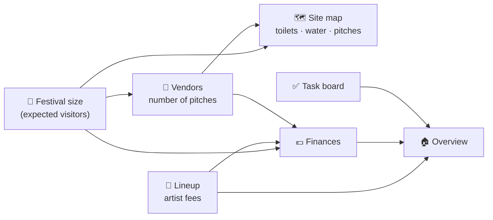

<div align="center">

# 🎪 Festival Architect

**Plan a complete music festival in one place —**
**from the first artist booking to the last check before the gates open.**


[](https://github.com/ameliepressl/Festival-Planner/actions/workflows/tests.yml)

Team project · *Introduction to Programming* · **Nova SBE**
Kira · Amelie · Frederik · Vicky

**▶ Live app: <https://ameliepressl.github.io/Festival-Planner/>**

[At a glance](#-at-a-glance) · [Team](#-team) · [Quick start](#-quick-start) · [Accounts](#-accounts) · [Features](#-features) · [Screenshots](#-screenshots) · [How it fits together](#-how-it-fits-together) · [Tests](#-tests) · [Project structure](#-project-structure) · [Roadmap](feature-plans/roadmap.md)

<br />


</div>

---

## 🎯 At a glance

| Area | What you can do |
| --- | --- |
| **Lineup** | Multi-day timetable for 1–12 stages, artist library with real artists, **automatic lineup suggestions**, budget warnings, PDF export |
| **Tasks** | Task board and Gantt timeline with suggested dates, assignments and deadlines |
| **Site map** | Aerial map with facility pins, own map upload, automatic layout with 10 rules, crowd and evacuation estimates |
| **Vendors** | Food-court pitches, vendor library, **add your own stands** with menu, prices and diet labels, visitor needs (vegan, alcohol-free) |
| **Finances** | Profit and loss, break-even, profit by ticket price, **scenarios with your own ticket numbers**, VIP / VAT / merch and other assumptions, **your own cost and income lines**, cash-flow plan |
| **Final checklist** | Event-day checks for 12 teams |
| **Accounts & teams** | Sign-up, up to 20 festivals per account, shared festivals with Admin / Editor / Viewer roles enforced by the database |
| **Demos** | Two ready-made festivals (Lisbon, small; Munich, large) to try everything at once |

**Tested automatically:** GitHub Actions runs the whole test suite on every pull request and every
push to `main` (badge above). A green check on a pull request means every test passed. Details: [Tests](#-tests).

## 👥 Team

| Name               | Student number | GitHub |
| ------------------ | -------------- | ------ |
| Kira Fraunhoffer   | 77848          | [kira-456](https://github.com/kira-456) |
| Amelie Pressl      | 83360          | [ameliepressl](https://github.com/ameliepressl) |
| Frederik Ronning   | 79575          | [FrederikRonning](https://github.com/FrederikRonning) |
| Victoria Fritsches | 78290          | [vfritsches](https://github.com/vfritsches) |

## 🚀 Quick start

**Use it online:** open <https://ameliepressl.github.io/Festival-Planner/> and create an account.
Nothing to install.

**Run it on your own computer:**

The app is plain HTML, CSS and JavaScript. Serve the folder with a static file server.
If Python 3 is available:

```bash
python3 -m http.server 8000
```

Open **<http://localhost:8000/>**, create an account (username, email, password) or sign in,
and keep the terminal running while you use the app. Stop it with `Ctrl + C`.
Python only serves the files; there is no Python application backend. The live link
shows the published version of `main`, which may differ from an unmerged local branch.

> [!TIP]
> After creating an account the Overview asks for the festival name, dates and opening hours —
> after that every section is ready to use.

## 🔐 Accounts

Each account can own **up to 20 festivals** and join shared festivals. Use the sidebar
festival selector and **New festival** to switch or create one. Loading the Lisbon or
Munich demo creates another festival and keeps the current one. The owner can delete
an owned festival in **Settings**, provided they still own another one.

Owners and Admins **invite teammates** by username in **Settings → Team**, as **Admin**,
**Editor** or **Viewer**. Editors can change the lineup and task progress; Viewers only
view. Finances, assignments and team administration have additional role restrictions.
The database enforces access through Row Level Security and guarded updates, rather
than relying only on disabled buttons.

Saved sections sync to Supabase and can be loaded on another device. Different sections
are merged; simultaneous edits to the same section can still overwrite one another.
Check the account saving status before leaving. If another tab changes the open festival,
reload the older tab before editing it.
Forgot your password? Choose **Forgot your password?** on the sign-in screen: the app emails a
link that opens **Choose a new password**.
Details: [login](feature-plans/login.md) · [shared festivals](feature-plans/shared-festivals.md) ·
[forgot password](feature-plans/forgot-password.md).

Accounts and saved festivals are stored in **Supabase**. One-time setup by the project owner:

1. Create a Supabase project and configure email/password authentication and its email
   confirmation behaviour for the course deployment.
2. Apply the numbered files in [`migrations/`](migrations/) in order in the Supabase
   SQL Editor. The database owner performs this step; the browser never runs SQL migrations.
3. Put the project URL and the **publishable** key into [`supabase-config.js`](supabase-config.js).
   Never the secret key — see [AGENTS.md → Secrets](AGENTS.md).
4. In *Authentication → URL Configuration*, set the Site URL to the deployed address and add
   `https://ameliepressl.github.io/Festival-Planner/**` and `http://localhost:8000/**` as
   Redirect URLs (the password reset link only opens addresses on this list).
5. Email sending: Supabase's built-in email service only sends to members of the Supabase
   organization, and only a few emails per hour. For password reset emails to everyone, set up
   custom SMTP in *Authentication → Emails → SMTP settings*.

Editors cannot change the festival details or the overall artist budget, also not through a
direct request (`migrations/006`, applied on 22 November 2026).

## ✨ Features

### Plan the programme
- **Overview** — festival facts, projected finances, tasks needing attention and a
  readiness score. Failed planning checks become linked issues on the task board;
  fixing their source clears them. Festival details and team management are in Settings.
- **Lineup planner** — a multi-day timetable for several stages. Book artists with agreed
  fees and set lengths, mark them tentative or confirmed, add calendar blocks, keep an eye on
  the budget, finalise the plan, print it as a PDF and save or restore a backup.
  **Suggest lineup** plans the catalogue automatically and shows a preview first (see the
  rules below).
- **Artist library** — search and filter real artists, then copy them into this festival's
  editable catalogue. Library fees are fictional planning estimates, not agency quotes.
  Available photos come from Wikimedia Commons, with attribution links; initials work
  when photos cannot load.

### Current lineup rules

- Choose the festival dates and opening hours, **1–12 stages** and an artist budget.
  Start times and durations use whole minutes, including times such as 15:11.
- Artists have editable names, genres, default fees and durations. Each booked performance
  keeps its agreed fee and duration even if the catalogue later changes. Fees may be zero.
- A stage cannot have overlapping appointments, including breaks and changeovers. The
  same artist cannot perform overlapping sets on different stages. Different artists
  may perform simultaneously on different stages.
- Repeated bookings of an artist are allowed after a warning and confirmation. Each
  performance contributes its own fee to the budget.
- A change that creates or increases a budget overrun requires confirmation. The remaining
  budget can be negative, and the app displays that clearly.
- **Suggest lineup** (orange button above the timetable) spreads the catalogue over days and
  stages within the opening hours: the chosen headliner closes the last day, no genre plays
  three times in a row on a stage, and there is a minimum changeover you choose. Confirmed
  performances and calendar blocks stay; new performances are tentative; nothing changes
  until you choose **Use this lineup**. The artist budget is no hard limit here either: the
  preview shows the remaining amount or the overrun, and a suggestion that creates or
  increases an overrun asks for the same confirmation as a manual booking. Artists are left
  out only when there is no free slot.
- There is no required artist count or minimum catalogue size. Finalising checks the
  existing appointments; the lineup then stays read-only until reopened as a draft.
- Add grey operational blocks and notes, edit or remove appointments, and optionally
  reserve a linked changeover after a performance. Public PDF output shows confirmed
  performances; internal output includes fees, operational blocks and private notes.

These are the active rules in the [current product brief](product-brief/festival-architect-brief.html).

### Organise the work
- **Project tasks** — a task board and editable Gantt timeline with suggested dates relative
  to the festival, assignments, filters and deadlines. Add or delete suggested/custom tasks;
  timeline edits use Save or Cancel. A fresh project starts with fresh task progress.

### Design the ground
- **Site map** — a realistic aerial view with a clickable pin for every facility: stages,
  gate, first aid, toilets, water, food court, emergency exits and more.
  - Upload your **own map** (aerial photo or site plan), draw the fence, set the gate and
    mark no-go areas — water is detected automatically.
  - **Suggest layout** places facilities for the active lineup stages according to **10 layout rules**
    (stage distance, first aid / toilets / water near every stage, exits far apart …),
    with a score. Drag pins to adjust; walkways route around water and forest.
  - **Festival size:** the expected visitors decide how many toilets, water points, food
    pitches, first aiders and security staff are needed.
  - Edits remain a draft until **Save changes**. **Undo change** reverses the last action;
    **Discard changes** returns to the saved map. Leaving with a draft asks first.
  - Enter usable audience areas, expected crowds and clear exit widths for density and
    evacuation estimates. The assumptions and chosen exit routes are visible. These are
    planning estimates, not a legal capacity assessment or safety approval.
- **Vendors** — the original catalogue plus a searchable vendor library, with fictional
  example stands, menus and prices. Confirm stands on food-court pitches, see pitch income
  and check visitor needs such as vegan food and alcohol-free drinks. **Add vendor** adds your
  own stand with its fee, description and a menu with prices and diet labels (edit or delete it later).

### Know the numbers
- **Finances** — profit and loss, **break-even** (tickets and price), where the money goes
  and comes from, **profit by ticket price**, **scenarios** (bad case · your plan · best case;
  drag a slider or type how many tickets sell in each), a cash-flow plan and an analysis of the artist
  spending. Every assumption can be changed, including **additional assumptions** (VIP and guest-list
  tickets, VAT, music licence, merch, grants, power, crew, cleaning, artist hospitality). **+ Add cost** /
  **+ Add income** adds your own lines (in total, per day, per visitor or per visitor per day), which
  flow into profit, break-even and the cash-flow plan.
  The model is a **simplified planning estimate**, not accounting or tax advice: profit is before income
  tax, VAT is only taken out of tickets (enter other amounts without VAT), sponsorship and pitch fees stay
  the same in every scenario, and security, toilets, first aid and water are sized for the expected
  visitors. The page lists these limits under *What this model leaves out*.

### Get ready for the day
- **Final checklist** — event-day checks for 12 teams, from security to radios, with a
  progress bar.

## 📸 Screenshots

These illustrative screenshots show an earlier *Lisbon Sound Festival* demo (2 days,
2 stages, 5,000 visitors). Dates and some controls differ from the current interface.

| Lineup planner | Site map |
| --- | --- |
|  |  |
| **Vendors** | **Finances** |
|  |  |

## 🔗 How it fits together

The sections share their data, so a change in one place shows up everywhere it matters.



## 🧪 Tests

The tests cover business-rule scenarios, calculations and selected page integrations.
Some use a simulated DOM or a mock Supabase client. They do not prove that every click,
browser, live account or database policy works.

```bash
uvx --from nodejs-wheel node --test
```

With Node already installed, `node --test` also works; GitHub CI uses Node 22 and runs on
pull requests and pushes to `main`. The `uvx` command requires `uv` and downloads Node.

The suite never contacts the real Supabase project. The access rules live in
[`migrations/`](migrations/). Manual local-browser checks, reloads, failed-storage checks
and real multi-account/database verification remain separate checks; see
[PROJECT_PROGRESS.md](PROJECT_PROGRESS.md) for what was actually exercised.

Original single-day regression exports remain in `rules/legacy-lineup-compatibility.js`
for Node tests. They are not loaded by the browser and do not set the current app's
requirements; the current lineup is checked by the multi-day rules and integration tests.

## 📁 Project structure

```text
index.html                    page structure for all sections
styles.css                    shared look
account/                      sign-in screen, saving the plan to the account, sign out
supabase-config.js            Supabase project URL + publishable key (public by design)
migrations/                   database tables and access rules (SQL, run in Supabase)
vendor/                       the pinned Supabase library
app.js                        lineup planner
overview.js                   overview and team roster
readiness.js                  shared planning checks and linked issue cards
artist-library/               searchable artist catalogue and optional photos
work-board.js · gantt-*.js    task board and Gantt chart
festival-countdown.js         days until the festival
site-map/                     site map and the aerial drawing
vendors/                      vendors
finance/                      financial overview
checkliste-festivalplanung/   final checklist
rules/                        all rules and calculations — no screen code
tests/                        automatic tests (JavaScript)
feature-plans/                one plan per feature, plus the roadmap
product-brief/                the product brief
```

## 🧭 Design principles

- **Separate rules from screens.** Shared rules and calculations live in `rules/` so they
  can be checked independently. Screen code handles dialogs, rendering and saving;
  those flows also need integration and browser checks.
- **One pinned dependency.** Plain HTML, CSS and JavaScript in the browser. The only
  third-party code is the Supabase library, copied into [`vendor/`](vendor/README.md) at an
  exact version with an integrity hash. Nothing to install, nothing that changes by itself.
- **The brief decides.** [`product-brief/`](product-brief/festival-architect-brief.html)
  wins over anything else.

**Course stack approval remains unconfirmed.** This project uses browser JavaScript
with Supabase. Check the [course stack guide](https://2477-introduction-programming.gitlab.io/wiki/guides/stack.html)
and obtain the teacher's confirmation for this stack; the team must not describe that
approval as already granted. 2FA is not part of the agreed feature scope.

## 🔒 Data & privacy

Supabase holds the accounts and saved festival sections. The owner and invited members
have access according to their roles. While you work, the browser keeps a local copy;
**successful sign-out removes the festival copy from that browser**. Public photo caches
may remain. Supabase Auth handles passwords; festival records do not contain passwords.

A festival is only visible to its owner and the teammates the owner or an Admin invited.
Database membership changes revoke server access. An already loaded page may still display
its cached copy until it notices the change or reloads; access control is enforced on
database reads and writes.

`supabase-config.js` contains the public project URL and **publishable** key, intended for
browser use. Secret/service-role keys, database passwords and access tokens must never be
committed. New saved plan sections use a `festival-` key so account sync includes them.

**Text from users is always shown as text.** Names, notes, task titles, stage names, own stands and own
finance lines are escaped before they go into the page, and saved data is checked again when it is
loaded, so a teammate cannot inject code into a shared festival. We audited every place that builds HTML
(`innerHTML`); see [the audit](feature-plans/html-safety-audit.md).

## 🤝 How we work

- Every feature starts from the latest `main` on **its own branch**, with a plan in
  `feature-plans/` first.
- Every pull request is **reviewed by another team member** and only merged when the tests
  pass.
- Tests are **never weakened** to make them pass.

More: [AGENTS.md](AGENTS.md) · [PROJECT_PROGRESS.md](PROJECT_PROGRESS.md) ·
**[Roadmap — what comes next](feature-plans/roadmap.md)**
