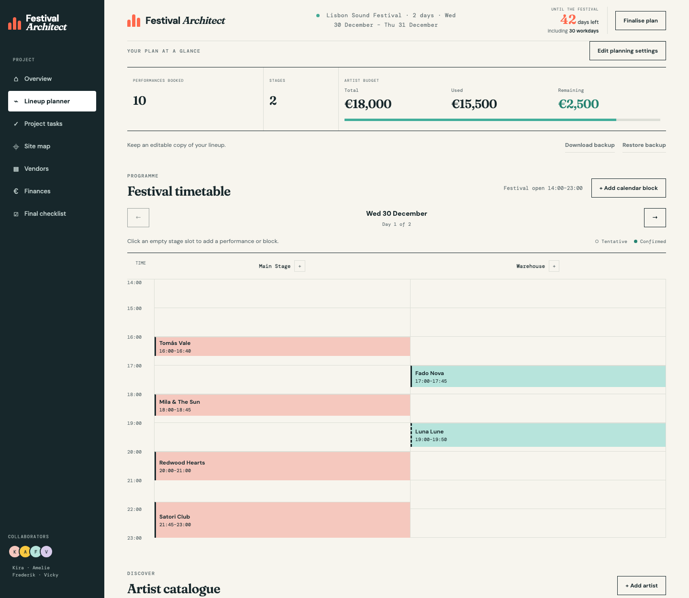
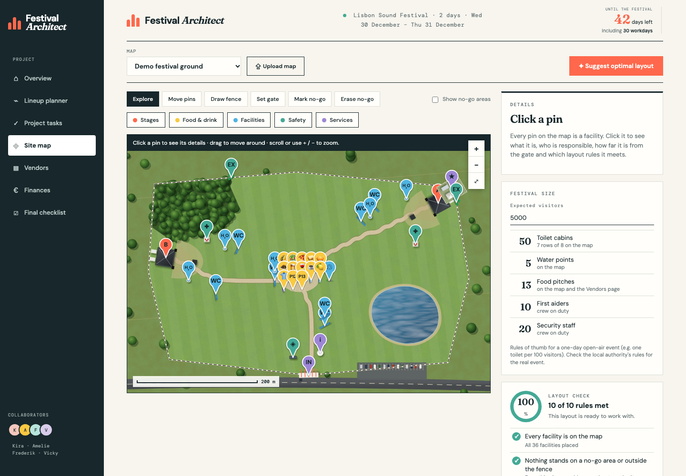
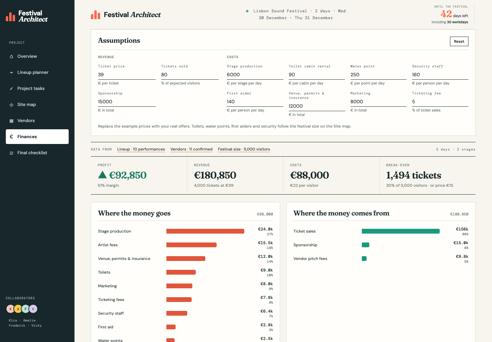
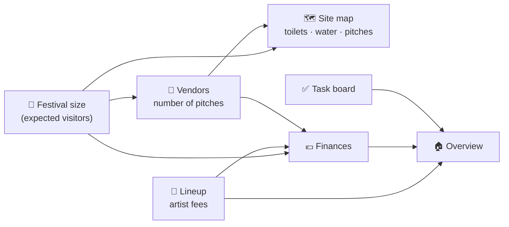

<div align="center">

# 🎪 Festival Architect

**Plan a complete music festival in one place —**
**from the first artist booking to the last check before the gates open.**


Team project · *Introduction to Programming* · **Nova SBE**
Kira · Amelie · Frederik · Vicky

**▶ Live app: <https://ameliepressl.github.io/Festival-Planner/>**

[Team](#-team) · [Quick start](#-quick-start) · [Accounts](#-accounts) · [Features](#-features) · [Screenshots](#-screenshots) · [How it fits together](#-how-it-fits-together) · [Tests](#-tests) · [Project structure](#-project-structure) · [Roadmap](feature-plans/roadmap.md)

<br />


</div>

---

## 👥 Team

| Name               | Student number | GitHub |
| ------------------ | -------------- | ------ |
| Kira Fraunhoffer   | 77848          | [kira-456](https://github.com/kira-456) |
| Amelie Pressl      | 83360          | [ameliepressl](https://github.com/ameliepressl) |
| Frederik Ronning   | 79575          | [FrederikRonning](https://github.com/FrederikRonning) |
| Victoria Fritsches | 78290          | [vfritsches](https://github.com/vfritsches) |

## 🚀 Quick start

**Use it online:** open <https://ameliepressl.github.io/Festival-Planner/> and create an account.
Nothing to install.

**Run it on your own computer:**

The app is plain files. Serve the folder with any static file server — Python's is already
installed on macOS:

```bash
python3 -m http.server 8000
```

Open **<http://localhost:8000/>**, create an account (username, email, password) or sign in,
and keep the terminal running while you use the app. Stop it with `Ctrl + C`.

> [!TIP]
> After creating an account the Overview asks for the festival name, dates and opening hours —
> after that every section is ready to use.

## 🔐 Accounts

Every person signs in and plans **their own festival**. The plan is saved to the account, so
it is the same on every device. Admins can **invite teammates** by their username in
*Overview → Team* as **Admin**, **Editor** or **Viewer**; teammates then open the festival from
the sidebar. The database itself enforces who may read and save what (Row Level Security).
Details: [login](feature-plans/login.md) · [shared festivals](feature-plans/shared-festivals.md).

Accounts and saved festivals are stored in **Supabase**. One-time setup by the project owner:

1. Create a Supabase project. In *Authentication → Sign In / Providers → Email*, switch off
   "Confirm email" (the free plan only sends a few emails per hour).
2. Run the files in [`migrations/`](migrations/) in order (001, 002, 003, 004, 005) in the Supabase
   *SQL Editor*.
3. Put the project URL and the **publishable** key into [`supabase-config.js`](supabase-config.js).
   Never the secret key — see [AGENTS.md → Secrets](AGENTS.md).
4. In *Authentication → URL Configuration*, add the deployed address and
   `http://localhost:8000`.

## ✨ Features

### Plan the programme
- **Overview** — the start page: festival details, projected finances, tasks that need
  attention, milestones and the team roster.
- **Lineup planner** — a multi-day timetable for several stages. Book artists with agreed
  fees and set lengths, mark them tentative or confirmed, add calendar blocks, keep an eye on
  the budget, finalise the plan, print it as a PDF and save or restore a backup.

### Organise the work
- **Task board** — project tasks with deadlines, a "needs attention" list and an editable
  **Gantt chart** of the whole preparation, plus a countdown to the festival.

### Design the ground
- **Site map** — a realistic aerial view with a clickable pin for every facility: stages,
  gate, first aid, toilets, water, food court, emergency exits and more.
  - Upload your **own map** (aerial photo or site plan), draw the fence, set the gate and
    mark no-go areas — water is detected automatically.
  - **Suggest optimal layout** places everything according to **10 layout rules**
    (stage distance, first aid / toilets / water near every stage, exits far apart …),
    with a score. Drag pins to adjust; walkways route around water and forest.
  - **Festival size:** the expected visitors decide how many toilets, water points, food
    pitches, first aiders and security staff are needed.
- **Vendors** — 24 food, drink and merch vendors for the food court pitches, pitch income
  and a check that visitors' needs are covered (vegan option, drinks, alcohol-free).

### Know the numbers
- **Finances** — profit and loss, **break-even** (tickets and price), where the money goes
  and comes from, **profit by ticket price**, **scenarios** (bad weather · plan · sold out)
  and an analysis of the artist spending. Every assumption can be changed.

### Get ready for the day
- **Final checklist** — event-day checks for 12 teams, from security to radios, with a
  progress bar.

## 📸 Screenshots

All screenshots show the example festival *Lisbon Sound Festival* (2 days, 2 stages,
5,000 visitors).

| Lineup planner | Site map |
| --- | --- |
|  |  |
| **Vendors** | **Finances** |
|  |  |

## 🔗 How it fits together

The sections share their data, so a change in one place shows up everywhere it matters.



## 🧪 Tests

All rules and calculations are covered by automatic tests.

```bash
uvx --from nodejs-wheel node --test
```

The tests never talk to Supabase. The database access rules are written down in
[`migrations/`](migrations/001_accounts_and_festivals.sql).

`uv` downloads Node by itself — nobody has to install Node.

## 📁 Project structure

```text
index.html                    page structure for all sections
styles.css                    shared look
account/                      sign-in screen, saving the plan to the account, sign out
supabase-config.js            Supabase project URL + publishable key (public by design)
migrations/                   database tables and access rules (SQL, run in Supabase)
vendor/                       the pinned Supabase library
app.js                        lineup planner
overview.js                   overview and team roster
work-board.js · gantt-*.js    task board and Gantt chart
festival-countdown.js         days until the festival
site-map/                     site map and the aerial drawing
vendors/                      vendors
finance/                      financial overview
checkliste-festivalplanung/   final checklist
rules/                        all rules and calculations — no screen code
tests/                        automatic tests (JavaScript)
feature-plans/                one plan per feature, plus the roadmap
product-brief/                the product brief
```

## 🧭 Design principles

- **Rules are separate from screens.** Every rule and calculation lives in `rules/`; the
  screens only show things and pass clicks on. That is why everything can be tested
  without a browser.
- **One pinned dependency.** Plain HTML, CSS and JavaScript in the browser. The only
  third-party code is the Supabase library, copied into [`vendor/`](vendor/README.md) at an
  exact version with an integrity hash. Nothing to install, nothing that changes by itself.
- **The brief decides.** [`product-brief/`](product-brief/festival-architect-brief.html)
  wins over anything else.

## 🔒 Data & privacy

Each festival plan is saved in Supabase under its account, and Row Level Security lets
only that account read or change it. While you work, the pages also keep a copy in your
browser; **signing out removes it**, so the next person on the same computer cannot see your
plan. Passwords are handled by Supabase and never stored by the app.

A festival is only visible to its owner and the teammates the owner or an Admin invited.
Removing someone from the team takes their access away immediately.

## 🤝 How we work

- Every feature starts from the latest `main` on **its own branch**, with a plan in
  `feature-plans/` first.
- Every pull request is **reviewed by another team member** and only merged when the tests
  pass.
- Tests are **never weakened** to make them pass.

More: [AGENTS.md](AGENTS.md) · [PROJECT_PROGRESS.md](PROJECT_PROGRESS.md) ·
**[Roadmap — what comes next](feature-plans/roadmap.md)**
