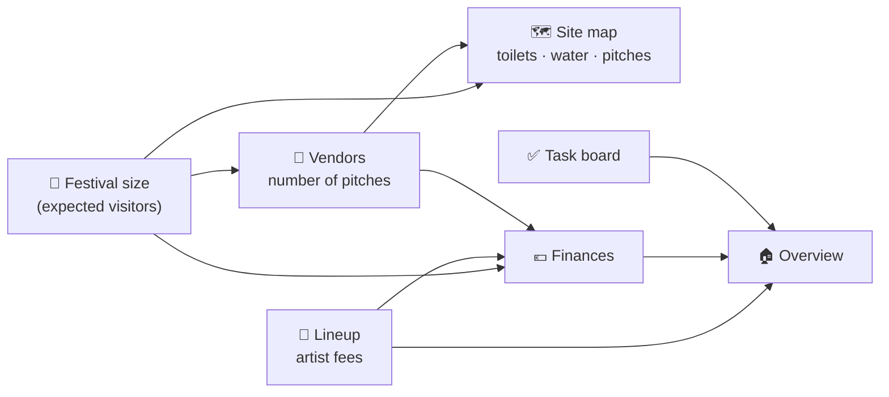

<div align="center">

# 🎪 Festival Architect

**Plan a complete music festival in one place —**
**from the first artist booking to the last check before the gates open.**


[](https://github.com/ameliepressl/Festival-Planner/actions/workflows/tests.yml)

Team project · *Introduction to Programming* · **Nova SBE**
Kira · Amelie · Frederik · Vicky

**▶ Live app: <https://ameliepressl.github.io/Festival-Planner/>**

[At a glance](#-at-a-glance) · [Start here](#-start-here) · [Team](#-team) · [Quick start](#-quick-start) · [Accounts](#-accounts) · [Release checks](#release-verification) · [Features](#-features) · [How it fits together](#-how-it-fits-together) · [Tests](#-tests) · [Project structure](#-project-structure) · [Data & privacy](#-data--privacy) · [How we work with AI](#-how-we-work-with-ai)

</div>

---

## 🎯 At a glance

| Area | What you can do |
| --- | --- |
| **Lineup** | Multi-day timetable for 1–12 stages, artist library with real artists, budget warnings, PDF export |
| **Tasks** | Task board and Gantt timeline with suggested dates, assignments and deadlines |
| **Site map** | Aerial map with facility pins, own map upload, automatic layout with 10 rules, crowd and evacuation estimates |
| **Vendors** | Food-court pitches, vendor library, **add your own stands** with menu, prices and diet labels, visitor needs (vegan, alcohol-free) |
| **Finances** | Profit and loss, break-even, profit by ticket price, **scenarios with your own ticket numbers**, VIP / VAT / merch and other assumptions, **your own cost and income lines**, cash-flow plan |
| **Final checklist** | Event-day checks for 12 teams |
| **Accounts & teams** | Sign-up, up to 20 festivals per account, shared festivals with Admin / Editor / Viewer roles enforced by the database |
| **Demos** | Two ready-made festivals (Lisbon, small; Munich, large) to try everything at once |

**Tested automatically:** GitHub Actions runs the whole test suite on every pull request and every
push to `main` (badge above). A green check on a pull request means every test passed. Details: [Tests](#-tests).

## 📍 Start here

New to the code? These five stops explain how the whole app works:

| # | Open | What it shows |
| --- | --- | --- |
| 1 | [product brief](product-brief/festival-architect-brief.html) | What we build and why; it wins over everything else |
| 2 | [`rules/festival-rules.js`](rules/festival-rules.js) | How a business rule looks: pure functions, no screen code (all rules: [`rules/`](rules/)) |
| 3 | [`tests/lineup-integration.test.js`](tests/lineup-integration.test.js) | Current multi-day scenarios, including minute-level times, flexible budgets and no finalisation minimum; CI runs all tests on every PR |
| 4 | [`migrations/006_admin_only_lineup_details.sql`](migrations/006_admin_only_lineup_details.sql) | How access is enforced in the database (Row Level Security), not by hidden buttons |
| 5 | [docs/ai-workflow.md](docs/ai-workflow.md) | How we plan, build, verify and review with AI |

## 👥 Team

| Name               | Student number | GitHub |
| ------------------ | -------------- | ------ |
| Kira Fraunhoffer   | 77848          | [kira-456](https://github.com/kira-456) |
| Amelie Pressl      | 83360          | [ameliepressl](https://github.com/ameliepressl) |
| Frederik Ronning   | 79575          | [FrederikRonning](https://github.com/FrederikRonning) |
| Victoria Fritsches | 78290          | [vfritsches](https://github.com/vfritsches) |

## 🚀 Quick start

**Use it online:** open <https://ameliepressl.github.io/Festival-Planner/> and create an account.
Nothing to install.

**Run it on your own computer:**

The app is plain HTML, CSS and JavaScript, so there is nothing to install or build.
Get a fresh copy and serve the folder with a static file server (Python 3 has one built in):

```bash
git clone https://github.com/ameliepressl/Festival-Planner.git
```

```bash
cd Festival-Planner
```

```bash
python3 -m http.server 8000
```

Open **<http://localhost:8000/>**, create an account (username, email, password) or sign in,
and keep the terminal running while you use the app. Stop it with `Ctrl + C`.
Python only serves the files; there is no Python application backend. The live link
shows the published version of `main`, which may differ from an unmerged local branch.

**Run the tests** (in the same folder; needs [`uv`](https://docs.astral.sh/uv/), which downloads Node for you):

```bash
uvx --from nodejs-wheel node --test
```

With Node 22 already installed, `node --test` does the same. More in [Tests](#-tests).

> [!TIP]
> After creating an account the Overview asks for the festival name, dates and opening hours —
> after that every section is ready to use.

## 🔐 Accounts

Each account can own **up to 20 festivals** and join shared festivals. Use the sidebar
festival selector and **New festival** to switch or create one. Loading the Lisbon or
Munich demo creates another festival and keeps the current one. The owner can delete
an owned festival in **Settings**, provided they still own another one.

Owners and Admins **invite teammates** by username in **Settings → Team**, as **Admin**,
**Editor** or **Viewer**. Editors can change the lineup and task progress; Viewers only
view. Finances, assignments and team administration have additional role restrictions.
The database enforces access through Row Level Security and guarded updates, rather
than relying only on disabled buttons.

Saved sections sync to Supabase and can be loaded on another device. Different sections
are merged. If two people change the same section, the later save is refused: a message names
the section, the edit stays in the browser, and the person chooses Keep mine or Use theirs
(`feature-plans/section-conflicts.md`; needs `migrations/007`).
Check the account saving status before leaving. If another tab changes the open festival,
reload the older tab before editing it.
Forgot your password? Choose **Forgot your password?** on the sign-in screen: the app emails a
link that opens **Choose a new password**.
Details: [login](feature-plans/login.md) · [shared festivals](feature-plans/shared-festivals.md) ·
[forgot password](feature-plans/forgot-password.md).

Accounts and saved festivals use **Supabase**. The database guards for festival details and
the overall artist budget are implemented and applied in
[`migrations/006`](migrations/006_admin_only_lineup_details.sql). Current verification checks
are listed below. Deployment configuration is documented separately in
[Supabase setup](docs/supabase-setup.md).

### Supabase dependency and recovery

GitHub Pages serves the website files; **Supabase provides sign-in, database permissions and
saved festival data**. We chose it to keep managed accounts and shared storage in one service.
This also creates a dependency: new sign-ins, loading or creating festivals and account saves
need Supabase to be available and correctly configured. A network outage, a paused project,
provider usage limits or incorrect authentication/database settings can interrupt these flows.
Password-reset delivery also depends on the configured email service.

An available session and a cached festival may let an already used browser continue working
locally during a connection failure. Temporary account-save failures keep changes pending in
that browser, show **“Not saved yet — no connection to your account. Retrying…”**, and retry
automatically. This is limited recovery, not full offline access or a second backup service.
Wait for **“Saved to your account”** before clearing browser data or signing out. If saving
fails during sign-out, the app offers **“Sign out without saving”**; that choice can discard
changes that have not reached the account. A permission rejection instead asks for a reload.

Different sections save independently, but simultaneous edits to the same section can still
overwrite one another. See the [release checks](#release-verification) before presenting.

## Release verification

These checks distinguish recorded outstanding verification from the checks to repeat before
a demonstration. They are not a list of missing features.

| Check | What to verify | Status |
| --- | --- | --- |
| **Live account permissions** | Use separate real accounts on the deployed app: Owner/Admin actions succeed; Editor/Viewer restrictions also hold for direct database requests. | Real-account verification pending; database protection is implemented and applied. |
| **Password-reset template** | Confirm with the database owner that the current reset-link template is applied, then test a reset through a university email address. | Configuration confirmation and delivery check needed. SMTP and redirect URLs are already recorded as configured. |
| **Saving and recovery** | Save and reload a festival, reopen it on another device, and check the pending-save/retry feedback during a connection failure. | Pre-demo recheck; automated account tests use a mock service. |
| **Final deployed version** | Confirm the intended `main` is live, tests pass, Supabase is available, and the chosen demo workflow works at the public URL. | Pre-demo recheck. |

The team records completed live checks in [PROJECT_PROGRESS.md](PROJECT_PROGRESS.md).
See the course's [demo preparation guide](https://2477-introduction-programming.gitlab.io/wiki/guides/preparing-the-demo.html)
for rehearsal and account-readiness checks.

## ✨ Features

### Plan the programme
- **Overview** — an animated live stage with the festival's name: lasers, confetti and a crowd
  moving to the beat. Its colours and tempo follow the lineup's main genre, and its landscape
  follows the venue (coast, mountains, park or city). Well-known cities add their landmark (Paris:
  Eiffel Tower; London: Big Ben and London Eye; Lisbon: the bridge; and over 100 more, from Tokyo to Cusco). Below it: festival facts, projected finances,
  tasks needing attention and a readiness score. Failed planning checks become linked issues on the task board;
  fixing their source clears them. Festival details and team management are in Settings.
- **Lineup planner** — a multi-day timetable for several stages. Book artists with agreed
  fees and set lengths, mark them tentative or confirmed, add calendar blocks, keep an eye on
  the budget, finalise the plan, print it as a PDF and save or restore a backup.
- **Artist library** — search and filter real artists, then copy them into this festival's
  editable catalogue. Library fees are fictional planning estimates, not agency quotes.
  Available photos come from Wikimedia Commons, with attribution links; initials work
  when photos cannot load.

### Current lineup rules

- Choose the festival dates and opening hours, **1–12 stages** and an artist budget.
  Start times and durations use whole minutes, including times such as 15:11.
- Artists have editable names, genres, default fees and durations. Each booked performance
  keeps its agreed fee and duration even if the catalogue later changes. Fees may be zero.
- A stage cannot have overlapping appointments, including breaks and changeovers. The
  same artist cannot perform overlapping sets on different stages. Different artists
  may perform simultaneously on different stages.
- Repeated bookings of an artist are allowed after a warning and confirmation. Each
  performance contributes its own fee to the budget.
- A change that creates or increases a budget overrun requires confirmation. The remaining
  budget can be negative, and the app displays that clearly.
- There is no required artist count or minimum catalogue size. Finalising checks the
  existing appointments; the lineup then stays read-only until reopened as a draft.
- Add grey operational blocks and notes, edit or remove appointments, and optionally
  reserve a linked changeover after a performance. Public PDF output shows confirmed
  performances; internal output includes fees, operational blocks and private notes.

These are the active rules in the [current product brief](product-brief/festival-architect-brief.html).

### Organise the work
- **Project tasks** — a task board and editable Gantt timeline with suggested dates relative
  to the festival, assignments, filters and deadlines. Create a work area with its first task
  in Add new task on the board or from the bottom row in timeline edit mode. Festival owners and Admins can assign subtasks through Edit task on the board or in
  timeline edit mode. They can also rename or delete work areas from either view and clear tasks
  from the timeline. Restore last deletion appears beside Manage work areas after a bulk deletion is saved. Timeline
  edits use Save or Cancel.
- **Notifications** — a bell in the top bar tells you when a task was assigned to you and by whom, and which
  of your tasks are due within 7 days or overdue. One click opens the task under *My tasks*;
  "Mark all as read" clears the counter, and open deadlines come back the next day.
  These are in-app notifications; teammates' changes appear after the festival is reloaded.

### Design the ground
- **Site map** — a realistic aerial view with a clickable pin for every facility: stages,
  gate, first aid, toilets, water, food court, emergency exits and more.
  - Upload your **own map** (aerial photo or site plan), draw the fence, set the gate and
    mark no-go areas — water is detected automatically.
  - **Suggest layout** places facilities for the active lineup stages according to **10 layout rules**
    (stage distance, first aid / toilets / water near every stage, exits far apart …),
    with a score. Drag pins to adjust; walkways route around water and forest.
  - **Edit pins right on the map:** drag any pin to move it, or click it for a small menu (Move · Remove).
    The **Pins to place** dock under the map takes pins off (drag them onto it) and puts them back.
  - **Clear all pins** starts from scratch (the gate can stay): place pins one by one, with a preview that
    refuses water, forest and spots outside the fence, or let **Fill the rest for me** plan what is missing.
  - **+ Add pin** adds extra toilets, water, first aid, a bar, info point, security post, recycling point or
    your own named pin (e.g. "VIP area"). Added toilets, water and first aid count in the layout check.
    New facilities use the preset naming style and appearance; your own pin names are preserved.
  - **Festival size:** the expected visitors decide how many toilets, water points, food
    pitches, first aiders and security staff are needed.
  - Edits remain a draft until **Save changes**. **Undo change** reverses the last action;
    **Discard changes** returns to the saved map. Leaving with a draft asks first.
  - Enter usable audience areas, expected crowds and clear exit widths for density and
    evacuation estimates. The assumptions and chosen exit routes are visible. These are
    planning estimates, not a legal capacity assessment or safety approval.
- **Vendors** — the built-in catalogue plus a searchable vendor library, with fictional
  example stands, menus and prices. Confirm stands on food-court pitches, see pitch income
  and check visitor needs such as vegan food and alcohol-free drinks. **Add vendor** adds your
  own stand with its fee, description and a menu with prices and diet labels (edit or delete it later).

### Know the numbers
- **Finances** — profit and loss, **break-even** (tickets and price), where the money goes
  and comes from, **profit by ticket price**, **scenarios** (bad case · your plan · best case;
  drag a slider or type how many tickets sell in each), a cash-flow plan and an analysis of the artist
  spending. Every assumption can be changed, including **additional assumptions** (VIP and guest-list
  tickets, VAT, music licence, merch, grants, power, crew, cleaning, artist hospitality). **+ Add cost** /
  **+ Add income** adds your own lines (in total, per day, per visitor or per visitor per day), which
  flow into profit, break-even and the cash-flow plan.
  Every **new festival starts with zero finance assumptions** and no custom cost or income lines.
  Saved projects keep their last values; both demo festivals retain their example figures.
  **Load example values** is an explicit optional action in Financial assumptions.
  The model is a **simplified planning estimate**, not accounting or tax advice: profit is before income
  tax, VAT is only taken out of tickets (enter other amounts without VAT), sponsorship and pitch fees stay
  the same in every scenario, and security, toilets, first aid and water are sized for the expected
  visitors. The page lists these limits under *What this model leaves out*.

### Get ready for the day
- **Final checklist** — event-day checks for 12 teams, from security to radios, with a
  progress bar.

## 🔗 How it fits together

The sections share their data, so a change in one place shows up everywhere it matters.



## 🧪 Tests

**582 tests in 52 files.** GitHub Actions runs the suite on every pull request
and every push to `main`.

```bash
uvx --from nodejs-wheel node --test
```

| The tests cover | Examples |
| --- | --- |
| **Accepted actions** | booking an artist, saving a plan, placing a pin, assigning a task |
| **Rejected actions** | overlapping sets on one stage, a pin in the lake, an Editor changing the budget, a Viewer saving |
| **Edge cases** | zero fees, overnight opening hours, empty or broken saved data, names with HTML in them |
| **Calculations** | budget, break-even, scenarios, toilets / water per visitor, crowd density and evacuation time |
| **Page flows** | selected screens with a simulated page and a mock Supabase client |

**They do not cover:** real clicks in every browser, the live Supabase project and its Row Level
Security policies, e-mail delivery, or the look of the pages. Some use a simulated DOM or a mock
Supabase client. The policies are recorded in [`migrations/`](migrations/); deployment and local
database checks are logged in [PROJECT_PROGRESS.md](PROJECT_PROGRESS.md). Current live-service
checks are listed under [Release verification](#release-verification).

With Node already installed, `node --test` also works; GitHub CI uses Node 22 and runs on
pull requests and pushes to `main`. The `uvx` command requires `uv` and downloads Node.

The suite never contacts the real Supabase project. The access rules live in
[`migrations/`](migrations/). Manual local-browser checks, reloads, failed-storage checks
and real multi-account/database verification remain separate checks; see
[PROJECT_PROGRESS.md](PROJECT_PROGRESS.md) for what was actually exercised.

**Current behaviour:** start with [`tests/lineup-integration.test.js`](tests/lineup-integration.test.js)
and [`tests/lineup-enhancements.test.js`](tests/lineup-enhancements.test.js), alongside the active
[product brief](product-brief/festival-architect-brief.html).

## 📁 Project structure

```text
index.html                    page structure for all sections
styles.css                    shared look
account/                      sign-in screen, saving the plan to the account, sign out
supabase-config.js            Supabase project URL + publishable key (public by design)
docs/supabase-setup.md         setup reference for a separate deployment
migrations/                   database tables and access rules (SQL, run in Supabase)
vendor/                       the pinned Supabase library
app.js                        lineup planner
overview.js                   overview and team roster
readiness.js                  shared planning checks and linked issue cards
artist-library/               searchable artist catalogue and optional photos
work-board.js · gantt-*.js    task board and Gantt chart
notifications.js              the bell: new tasks, due soon and overdue
festival-countdown.js         days until the festival
site-map/                     site map and the aerial drawing
vendors/                      vendors
finance/                      financial overview
checkliste-festivalplanung/   final checklist
rules/                        all rules and calculations — no screen code
tests/                        automatic tests (JavaScript)
feature-plans/                one plan per feature (start from _TEMPLATE.md), plus the roadmap
product-brief/                the product brief
docs/ai-workflow.md           how we plan, build, verify and review with AI
AGENTS.md · CLAUDE.md         shared rules for every AI agent (CLAUDE.md loads AGENTS.md)
CONTRIBUTING.md               step-by-step checklist and Definition of Done
.github/                      CI workflow, pull request and issue templates
```

## 🧭 Design principles

- **Separate rules from screens.** Shared rules and calculations live in `rules/` so they
  can be checked independently. Screen code handles dialogs, rendering and saving;
  those flows also need integration and browser checks.
- **One pinned dependency.** Plain HTML, CSS and JavaScript in the browser. The only
  third-party code is the Supabase library, copied into [`vendor/`](vendor/README.md) at an
  exact version with an integrity hash. Nothing to install, nothing that changes by itself.
- **The brief decides.** [`product-brief/`](product-brief/festival-architect-brief.html)
  wins over anything else.

**Approved language choice.** The team has confirmed with the professor that using programming
languages other than Python is allowed. This project uses HTML, CSS and browser JavaScript
with Supabase rather than the course's default Python stack (see the
[course stack guide](https://2477-introduction-programming.gitlab.io/wiki/guides/stack.html)).
2FA is not part of the agreed feature scope.

## 🔒 Data & privacy

**Where the example data comes from**

| Data | Source | Note |
| --- | --- | --- |
| Artist library (387 artists) | Real artist names and genres, [`rules/artist-library.js`](rules/artist-library.js) | Fees are **fictional planning estimates**, not real quotes |
| Artist photos | Loaded from Wikimedia Commons via Wikipedia, with attribution links | Not stored in the repository; initials when no photo loads |
| Vendors (24 + 172 in the library) | Fictional stands, menus and prices, [`rules/vendor-rules.js`](rules/vendor-rules.js), [`rules/vendor-library.js`](rules/vendor-library.js) | Dish photos from Wikimedia Commons |
| Demo festivals (Lisbon, Munich) | Fictional, [`rules/demo-festival.js`](rules/demo-festival.js) | Lineups fit their stages, hours and budgets |
| Site map ground | Drawn by the app; your own map upload stays in your festival | |
| Rules of thumb (toilets, water, crowd density) | Planning estimates in [`rules/`](rules/) | Not a legal capacity or safety assessment |

**Who can see what**

Supabase holds the accounts and saved festival sections. The owner and invited members
have access according to their roles. While you work, the browser keeps a local copy;
**successful sign-out removes the festival copy from that browser**. Public photo caches
may remain. Supabase Auth handles passwords; festival records do not contain passwords.

A festival is only visible to its owner and the teammates the owner or an Admin invited.
Database membership changes revoke server access. An already loaded page may still display
its cached copy until it notices the change or reloads; access control is enforced on
database reads and writes.

`supabase-config.js` contains the public project URL and **publishable** key, intended for
browser use. Secret/service-role keys, database passwords and access tokens must never be
committed. New saved plan sections use a `festival-` key so account sync includes them.
Data that belongs to one person in one browser uses an `fa-` key and is never synced, e.g. which
notifications you have read (only task numbers, per festival and person).

**Text from users is always shown as text.** Names, notes, task titles, stage names, own stands and own
finance lines are escaped before they go into the page, and saved data is checked again when it is
loaded, so a teammate cannot inject code into a shared festival. We audited every place that builds HTML
(`innerHTML`); see [the audit](feature-plans/html-safety-audit.md).

## 🤝 How we work with AI

The course encourages AI, and we use it deliberately: **people specify, decide and review; AI agents
draft, implement and check.** We use AI wherever it makes us faster (implementation from a plan, tests,
audits, repetitive work), but **we never hand over control**: decisions, pushes, merges and database changes
stay with people. Code written by an agent goes through the same steps as code written by hand:

1. **Plan** first in `feature-plans/` (Why · What · Out of scope · Done when, [template](feature-plans/_TEMPLATE.md)).
2. **Shared rules for every agent** in [AGENTS.md](AGENTS.md): rules only in `rules/`, access enforced in the
   database, no secrets, and tests are **never weakened** to make them pass.
3. **Its own branch** from the latest `main`; tests written together with the code.
4. **Verified** by the full test suite and a check in a real browser.
5. **Pull request** with plan, AI use and test output ([template](.github/pull_request_template.md)),
   reviewed and merged by a teammate, only with green CI.

The full process, the risks of AI-written code and how we control them, real examples of where we caught
the AI, and how we review together: **[docs/ai-workflow.md](docs/ai-workflow.md)**.
Checklist for contributors: [CONTRIBUTING.md](CONTRIBUTING.md).

More: [AGENTS.md](AGENTS.md) · [CONTRIBUTING.md](CONTRIBUTING.md) · [Supabase setup](docs/supabase-setup.md)
