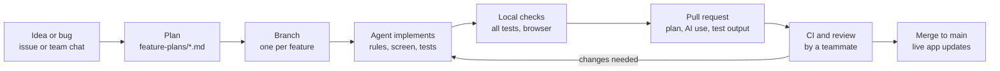

# How we build with AI

Festival Architect was built by four people working with AI coding agents (Claude Code and Codex).
The course encourages AI use, so we treat it as an engineering practice, not a shortcut:
**people decide what to build and whether it is good enough; agents draft, implement and check.**
We use AI as much as it helps, but the decisions, the pushes and the merges stay with us.
Code written by an agent goes through the same gates as code written by hand.

| Read | For |
| --- | --- |
| This page | Why and how we work with AI, how we review, and what we learned |
| [`AGENTS.md`](../AGENTS.md) | The rules every agent follows in this repository |
| [`CONTRIBUTING.md`](../CONTRIBUTING.md) | The step-by-step checklist and the Definition of Done |

## By the numbers

*As of 23 November 2026, on `main`, after seven weeks (first commit 6 October 2026).*

| | |
| --- | --- |
| Merged pull requests | 48, from all four team members |
| Feature plans written before building | 50 in [`feature-plans/`](../feature-plans/) |
| Automated tests | 498 in 46 test files, run by CI on every pull request |
| Rule modules (logic without screen code) | 21 in [`rules/`](../rules/) |
| Database migrations (access rules) | 6 in [`migrations/`](../migrations/) |
| Commits on `main` | more than 135; over 60 carry an AI co-author line |

---

## 1. The lifecycle of a change

| Step | Who leads | Output |
| --- | --- | --- |
| **Specify** | Person | A plan with *Why · What · Out of scope · Done when* ([template](../feature-plans/_TEMPLATE.md)). The [product brief](../product-brief/festival-architect-brief.html) wins over everything else. |
| **Implement** | Agent, steered by the person | Code on its own branch. Rules go into `rules/` as small functions without screen code; screens only call them. Tests are written with the code. |
| **Verify** | Agent first, then the person | The full test suite (output pasted into the PR) and the changed flow in a real browser, including a reload. |
| **Review** | A teammate who is not the author | Reads plan and diff, tries the change, approves or asks for changes. |
| **Merge** | Person | Only with green CI. `main` is published to the live app automatically. |

**The plan is the prompt.** An agent session starts from the feature plan plus `AGENTS.md`, not from a
one-line request. The plan's *Done when* list is what the agent's tests have to prove and what the
reviewer checks.

## 2. We stay in control, the AI makes us fast

The goal is to get as much out of AI as possible **without handing over control**.

**What always stays with people**

| Decision | Who |
| --- | --- |
| What to build, and what not (plan, *Out of scope*) | The feature owner, based on the product brief |
| Whether a result is correct and good enough | The author, then the reviewer |
| Pushing, opening pull requests and merging | A person, every time; agents act on explicit instruction only |
| Database changes | Only the database owner runs a migration |
| Secrets and accounts | Never handed to an agent |
| Changing or removing a test | Never done by an agent to make a test pass; a requirement change is decided by a person and named in the PR |

**Where the AI saves us the most time**

- **Implementation from a clear plan.** Once the *Done when* list is written, an agent turns it into rules,
  screen code and tests in one session.
- **The repetitive work.** Test scenarios, edge cases, merge conflicts in version strings and README updates
  take minutes instead of hours.
- **Checks no one has time for by hand.** Audits across the whole code base (e.g. every place that builds
  HTML), checking numbers in tests by recalculation, rehearsing the merge order before merging.
- **Context written once, reused by everyone.** `AGENTS.md` holds the conventions, so nobody repeats them
  in every prompt and every teammate's agent works the same way.
- **Parallel work.** One branch and one plan per feature lets four people and their agents work at the
  same time without getting in each other's way.

## 3. Guardrails for agents

[`AGENTS.md`](../AGENTS.md) is the single source of truth for every tool: Codex reads it directly and
[`CLAUDE.md`](../CLAUDE.md) imports it for Claude Code. The rules that matter most:

- **Tests are never weakened.** An agent may not edit, skip or delete a test to make it pass; if a
  test looks wrong it must say so and stop. When a requirement really changes, the PR names the test
  and the reason (examples: the Munich demo in [#28](https://github.com/ameliepressl/Festival-Planner/pull/28),
  the scenario order rule in [#35](https://github.com/ameliepressl/Festival-Planner/pull/35)).
- **Rules live in `rules/`, never only in the screen.** Logic stays testable without a browser, and an
  agent's work can be reviewed function by function.
- **Access is enforced by the database.** Roles (Owner, Admin, Editor, Viewer) are checked by Row Level
  Security in [`migrations/`](../migrations/), not by hidden buttons. Only the database owner runs migrations.
- **No secrets in code or prompts.** Only the publishable Supabase key is in the repository.
- **Small scope.** One feature per branch; other findings are noted, not fixed on the side.
- **Plain language.** Several of us are beginners, so agents explain every change.

## 4. Risks of AI-written code and how we control them

| Risk | Control |
| --- | --- |
| Plausible but wrong logic | Rules as small pure functions with scenario tests; *Done when* items checked in review |
| A test "fixed" instead of the code | Hard rule in `AGENTS.md`; any changed test is named and explained in the PR |
| Security holes (e.g. injected HTML, bypassed roles) | Escaping rule, targeted [HTML safety audit](../feature-plans/html-safety-audit.md), access enforced in the database |
| Invented facts or data | Fees and vendor details are labelled as fictional estimates; artist photos come from Wikimedia Commons with attribution |
| Changes nobody on the team understands | Plain-language explanations, one owner per feature, plans written by people |
| Scope creep from a fast agent | One feature per branch, *Out of scope* section in every plan |
| Secrets leaking into prompts or code | Only the publishable key is committed; secret keys never enter code, issues or agent chats |

## 5. Quality gates

| Gate | How | Where to see it |
| --- | --- | --- |
| Automated tests | Node test runner: business-rule scenarios and page integrations | [`tests/`](../tests/); output in every PR |
| Continuous integration | GitHub Actions runs all tests on each pull request and push to `main` | [workflow](../.github/workflows/tests.yml), badge in the README |
| Browser check | Changed flow, reload, phone width, console errors | Verification notes in the PR or plan |
| Peer review | Changes are reviewed together, side by side in person, before merging | The reviewer is named in the pull request |
| Security review | Targeted audits | [HTML safety audit](../feature-plans/html-safety-audit.md), [#32](https://github.com/ameliepressl/Festival-Planner/pull/32) |
| Database rules | Row Level Security as numbered migrations | [`migrations/`](../migrations/) |

## 6. Where a person caught or corrected the AI

- **Roles bypassed through a direct request.** A technical audit found that Editors could still change
  Admin-only festival details by sending a request directly, although the screen hid the buttons. The
  rule was moved into the database ([#32](https://github.com/ameliepressl/Festival-Planner/pull/32)).
- **Injected HTML in a vendor message.** An audit of every `innerHTML` use found one message that showed
  a stand name without escaping it. A failing test came first, then the fix
  ([#34](https://github.com/ameliepressl/Festival-Planner/pull/34)).
- **The audit tool was wrong at first.** Its helper script skipped templates nested inside `.map(...)`;
  the suspiciously short result list was questioned, the script fixed and the audit run again
  ([audit, "How we checked"](../feature-plans/html-safety-audit.md)).
- **A requirement change handled openly.** When the scenarios got the order rule
  *bad case ≤ your plan ≤ best case*, one test of the same PR no longer fit; it was updated to the new
  rule, kept as strict, and the plan says so ([#35](https://github.com/ameliepressl/Festival-Planner/pull/35)).
- **A merge conflict caught before merging.** The merge order of #34 → #35 → #36 was rehearsed on a
  throwaway branch; a conflict in `index.html` was found and resolved in advance (noted in #35).

## 7. Reviewing together in person

We review side by side rather than only through GitHub comments. The author walks a teammate through
the plan, the diff and the running app; questions are answered on the spot, and the author merges once
both agree and CI is green. This has three advantages for AI-written code:

- **Everyone understands the code, not only the agent.** Explaining a change out loud is the fastest
  test of whether the author really understands what the agent built.
- **Short feedback loops.** Problems found in the session are fixed in the same sitting.
- **Shared knowledge.** Every teammate has seen most parts of the app, which keeps the project
  maintainable by the whole team.

The [pull request template](../.github/pull_request_template.md) now also records who reviewed and what
to look at closely, so the review is documented on GitHub as well.

## 8. How the process grew

- **From one rule file to twenty-one.** As the app grew, rules were split into one module per area in
  `rules/`; `AGENTS.md` was updated with it, and keeping `README.md` and `AGENTS.md` current is part of the
  Definition of Done and the plan template.
- **One template for every pull request**, so plan, AI use, tests and browser check are always in the
  same place.
- **Next step: browser automation.** Page tests use a simulated page today and every change is also
  checked by hand in a real browser; a tool such as Playwright would automate those checks.

## 9. What we learned

- **A good plan is the best prompt.** In our experience, features with a clear *Done when* list needed
  far fewer correction rounds than loosely described ones.
- **Pure rule functions make AI output reviewable.** Small tested functions are easy to check; large
  screen files are not.
- **AI is fast; verification is the bottleneck.** A large share of our time went into checking, browser
  testing and review, which is where it belongs.
- **Shared rules beat individual prompting.** With conventions in `AGENTS.md`, every teammate's agent
  followed the same standards.
