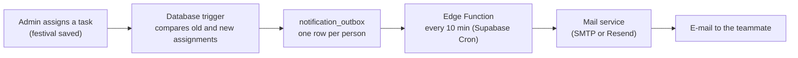

# Feature — Notifications for assigned tasks

Owner: Frederik · Branch: `feature-notifications` · Builds on: [task-assignments.md](task-assignments.md)

## Why

Owners and Admins can hand out tasks, but the person who gets a task is not told about it. They
only find out if they happen to open the task board and filter for their name. Tasks that are
due soon or already overdue are also easy to miss. A notification closes this gap and turns task
assignment into a complete workflow: assign → get notified → open the task → mark it done.

## What

- [x] A bell in the top bar with a counter of unread notifications (hidden when there are none).
- [x] Clicking the bell opens a list with three kinds of notifications, newest and most urgent first:
  - **New:** "You were assigned *4.5 Communicate visitor information*"
  - **Due soon:** "*Book security staff* is due in 3 days" (within the next 7 days, not done)
  - **Overdue:** "*Order toilets* is 2 days overdue" (shown in red)
- [x] Clicking a notification opens Project tasks with the existing filter "Assigned to me".
- [x] "Mark all as read" sets the counter to 0. Due-soon and overdue items come back the next day
      while the task is still open, so nothing urgent disappears for good.
- [x] **Rules in `rules/notification-rules.js`** (no screen code), reusing `assigneeOf` from
      `rules/task-rules.js`:
  - `newAssignmentsFor({ steps, assignments, people, myUserId, seen })`: subtasks that are now mine
    and were not mine when I last looked.
  - `deadlineNotices({ steps, assignments, people, myUserId, today })`: my open subtasks that are
    due within 7 days or overdue; done tasks never notify.
  - `notificationsFor(...)`: one sorted list (overdue → due soon → new) and the unread count.
- [x] **Screen:** visible for everyone who has tasks assigned (Owner, Admin, Editor, Viewer). It
      only reads the plan, so it never changes festival data.
- [x] **Read state** is stored in the browser under `fa-notifications-seen-v1:<festival id>:<user id>`.
      It must **not** start with `festival-`: every `festival-` key is saved into the shared plan
      (`rules/account-rules.js` → `isSyncedKey`), and one person's read state must not reach the team.

## Out of scope

- E-mail or push notifications. They need a server function, a mail service with a secret key and
  a database change, see [Next step: e-mail notifications](#next-step-e-mail-notifications).
- Live updates while the app is open: notifications are computed when a festival is opened or
  the plan is reloaded.
- Read state across devices (it is kept per browser).
- No database migration and no new keys or dependencies.

## Done when

- [x] An Editor who was given a task by an Admin sees "🔔 1" after opening the festival.
- [x] A task assigned to someone else, a task already seen, and a done task do not notify.
- [x] A subtask without a due date never shows up as due soon or overdue.
- [x] Someone who is no longer on the team gets no notifications for that festival.
- [x] Notification text is escaped (task titles are user input; see the HTML safety audit).
- [x] The read-state key is never part of what is saved to the shared festival.
- [x] Tests in `tests/notification-rules.test.js` cover the rules and the main page flow,
      including the rejected cases above.
- [x] All tests pass; tried in the browser including a reload and at phone width.
- [x] `README.md` (Features) updated.

## Tests

**Added**
- `tests/notification-rules.test.js` (15 tests): the read-state key is never synced; broken saved state
  is dropped; only my subtasks (through the group or the subtask), never someone who left the team;
  order overdue → due soon → new; done and other people's tasks never notify; "Mark all as read" and
  deadlines coming back the next day; a task assigned later shows up as new; no due date → never a
  deadline; the 7-day limit; the 9+ counter; singular/plural sentences.
- `tests/notifications-page.test.js` (10 tests): hidden without an account and for someone not on the
  team; the counter and sentences; task titles with HTML stay text; opening and closing; "Mark all as
  read" writes only the `fa-` key, never a `festival-` key; a broken saved state does not break the
  page; a click opens Project tasks with *My tasks*; an empty list tells Owner and Admins where tasks are assigned (the Owner choice only appears for the selected subtask in the Timeline), and others who assigns them.

**Result:** `uvx --from nodejs-wheel node --test` → 447 tests, 447 pass, 0 fail (422 before + 25 new).

**Checked by hand** (local copy on port 8019, Munich demo, a signed-in Editor simulated in the browser
console, two due dates moved to make one task overdue and one due soon):
- Without an account the bell is hidden.
- With 6 assigned subtasks: "6" on the bell; overdue first (red), due soon, then new; Amelie's tasks left out.
- Clicking the overdue notification opens Project tasks with *My tasks*, the card focused and highlighted.
- "Mark all as read": counter gone, deadlines stay listed without the dot; still read after a reload.
- A task group assigned afterwards shows up as 3 new notifications.
- Phone width (375 px): the list opens just below the bell, fits the screen, no sideways scrolling.
  (First try covered the bell; fixed by opening the list below it.)
- No console errors. All test data removed afterwards.

## Next step: e-mail notifications

Decided by the team on 23 November 2026: not built yet. Doing it properly needs a mail service
account, a secret key and a database change by the database owner, and it would not have been live
and tested before the submission deadline. This is how we would build it.

**Why it must run on a server.** The browser never knows a teammate's e-mail address: addresses are
kept only in Supabase Auth (`auth.users`), and `profiles` holds just the username. That is on purpose
(privacy). So the e-mail has to be sent by the server, with a key that never reaches the browser.

1. **Migration `007_email_notifications.sql`** (run by the database owner):
   - Table `notification_outbox` (festival, person, what happened, `created_at`, `sent_at`).
     Row Level Security on and no access through the API, so nobody can read or fill it from a browser.
   - A trigger on `festivals`: when `festival-task-assignments-v1` changes, it adds a row for each person
     who received new tasks. Only people on the festival's team qualify.
   - A column in `profiles` so everyone can switch e-mails off (on by default for assigned tasks).
2. **Edge Function `send-notifications`** (Supabase, server side):
   - Reads unsent rows, looks up the address in Supabase Auth, sends **one summary e-mail per person**
     ("You have 3 new tasks in Munich Loud Weekend") with a link to the app, then sets `sent_at`.
   - Once a day it also sends a reminder for tasks due within 7 days or overdue, reusing the rules of
     `rules/notification-rules.js`.
   - Failed sends stay unsent and are retried; `sent_at` prevents duplicates.
3. **Secrets:** the mail service key is stored only as a Supabase secret by the database owner, never
   in the repository, an issue or an agent chat (`AGENTS.md` → Secrets).
4. **Delivery:** Supabase's built-in mailer and test senders only reach our own addresses. E-mail to
   every user needs a mail service with a verified domain, or SMTP with its own sending limits.
5. **Tests:** the comparison "who received new tasks" as a pure function with scenario tests (new
   person, removed person, same tasks, someone not on the team); the Edge Function tested against a
   fake mail service; a real e-mail checked once by hand.

**Limits of the in-app version until then:** notifications appear when the app is opened, and the
read state is kept per browser.
